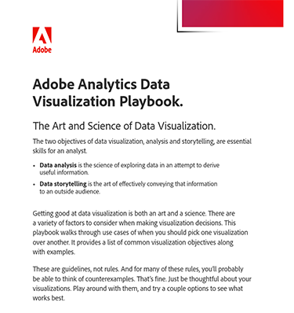

# Playbook für die Adobe Analytics-Datenvisualisierung

Datenvisualisierung ist sowohl Kunst als auch Wissenschaft und erfordert eine sorgfältige Berücksichtigung verschiedener Faktoren. Um Ihnen die Navigation bei einigen dieser Entscheidungen zu erleichtern, haben wir das Playbook für die Datenvisualisierung zusammengestellt.

[Herunterladen](assets/adobe-analytics-data-visualization-playbook.pdf) des Adobe Analytics-Visualisierungs-Playbooks

Unabhängig davon, ob Sie gängige Geschäftsfragen ansprechen oder sich mit komplexen Analysen befassen, zeigt dieses umfassende Playbook eine Reihe von Anwendungsfällen, wann und wie verschiedene Visualisierungen effektiv verwendet werden können.

## Autor

Dieses Dokument wurde von David Geist,
Data Insights Business Consultant bei Adobe.
