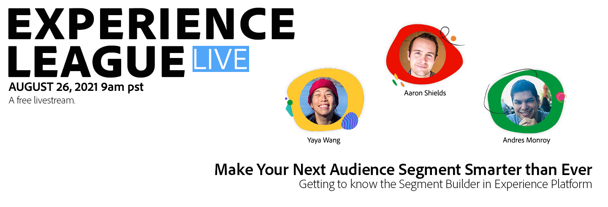
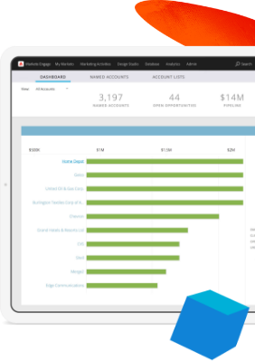
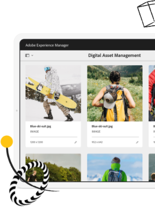
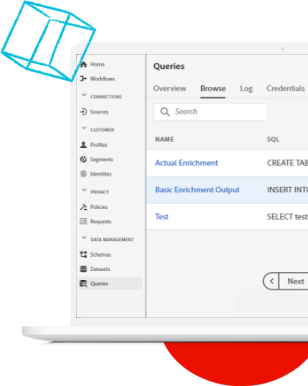
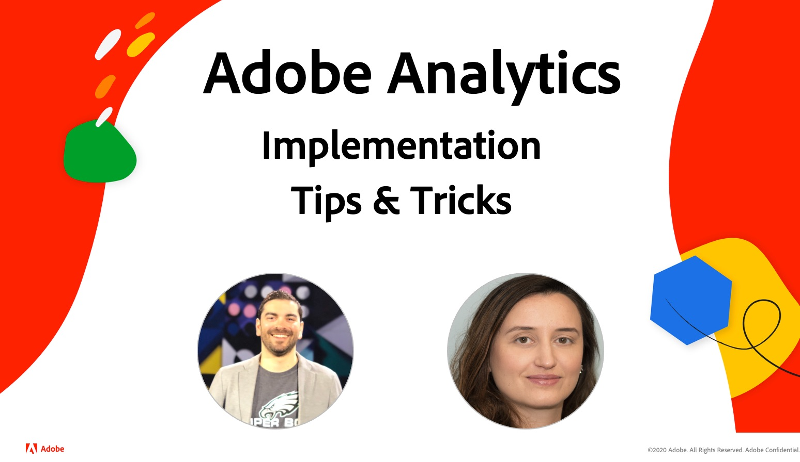

# Experience League LIVE

## Nehmen Sie an der nächsten Folge teil!

Experience League LIVE ist eine vom Experience League-Team veranstaltete Live-Streaming-Show.  Dort haben Sie Gelegenheit, sich mit Produktexperten von Adobe auszutauschen und praktische Tipps, Tricks und Strategien für die Arbeit mit den Anwendungen rund um Adobe Experience Cloud zu erlernen.

## Dieses spannenden Veranstaltungen erwarten Sie bei Experience League LIVE als Nächstes!

<table>
<tr>
  <td>
      
     

          <strong>Customer Journeys</strong>
     

     

          <em>September 2021</em>
     

    

    <em> Produktexperten zeigen auf, wie sich Erlebnisse in Echtzeit an Kunden anpassen lassen</em>
    

  </td>
  <td>
      
     

          <strong>Content and Commerce</strong>
     

          <em>Oktober 2021</em>
     

     

    

    <em>Wissenswertes zur Content-Erstellung und -Verwaltung in großem Maßstab sowie zur Umsetzung personalisierter Commerce-Erlebnisse</em>
    

  </td>
  <td>
      
     

          <strong>Experience Platform</strong>
     

     

          <em>Dezember 2021</em>
     
    
    

    <em>Produktexperten zeigen auf, wie sich Erlebnisse in Echtzeit an Kunden anpassen lassen</em>
    

  </td>
</tr>
</table>

## Frühere Folgen

Haben Sie eine Folge von Experience League LIVE verpasst? Das kann natürlich einmal vorkommen. Dann sehen Sie sich die früheren Folgen einfach jetzt an!

<table>
<tr>

<td>
    
     

          <strong>Gäste</strong>: <i>Eric Matisoff und Dasha Fitzpatrick</i>
     

     

          <em>29. Juli 2021</em>
     
    
    

    <em></em>
    

  </td>
</tr>
</table>

>[!TIP]
>
>Weitere Lernmöglichkeiten finden Sie in unseren kostenlosen [Kursen](https://experienceleague.adobe.com/?lang=de#dashboard/learning) sowie in den einzelnen [Tutorials](https://experienceleague.adobe.com/docs/home-tutorials.html?lang=de).
